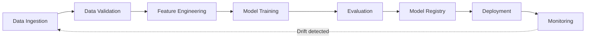

<div align="center">


&nbsp;&nbsp;

&nbsp;&nbsp;

&nbsp;&nbsp;

&nbsp;&nbsp;


# MachineLearning_Operations

**Production-grade Machine Learning Operations (MLOps) — from experiment to deployment.**

[](https://www.python.org/)
[](https://mlflow.org/)
[](https://dvc.org/)
[](https://www.docker.com/)
[](https://fastapi.tiangolo.com/)
[](LICENSE)

[](https://pypi.org/project/chandan-aiops/)
[](https://pypi.org/project/chandan-aiops/)
[](https://github.com/chandanc5525/MachineLearning_Operations/stargazers)
[](https://github.com/chandanc5525/MachineLearning_Operations/network/members)
[](https://github.com/chandanc5525/MachineLearning_Operations/issues)

</div>

---

## 📖 Overview

**MachineLearning_Operations** is a hands-on repository dedicated to building, tracking, deploying, and monitoring machine learning systems the way they are done in production: reproducible, automated, and observable.

It brings together the core pillars of MLOps:

| Pillar | What it covers |
|---|---|
| 🧪 **Experiment Tracking** | Log parameters, metrics, and artifacts for every run |
| 🗂️ **Data & Model Versioning** | Reproducible datasets and models with Git + DVC |
| 🔁 **CI/CD Automation** | Automated testing, builds, and deployments |
| 🐳 **Containerization** | Portable environments with Docker |
| 🚀 **Model Serving** | Low-latency REST inference APIs |
| 📊 **Monitoring** | Track performance and data drift after deployment |

---

## 🚀 Start Your Own MLOps Project in One Command — `chandan-aiops`

<div align="center">

[](https://pypi.org/project/chandan-aiops/)

</div>

Tired of spending hours wiring up folders, configs, Docker, and CI before writing your first line of model code? **[`chandan-aiops`](https://pypi.org/project/chandan-aiops/)** is my open-source Python package on PyPI that scaffolds a **standardized, production-ready MLOps/AIOps project** instantly.

```bash
pip install chandan-aiops
aiops-create my_ai_project
```

**What you get:**

- ⚡ **One-command setup** — a complete AI/ML project structure in seconds
- 🏭 **Production-ready template** — configuration, logging, Docker, CI/CD, and more
- 📁 **Standardized structure** — clean, scalable, maintainable folder layout
- ✅ **Best practices built in** — pre-configured for **MLflow**, **DVC**, **FastAPI**, and testing
- 🔧 **Extensible** — a solid foundation for any AI project

> 👉 **[View on PyPI](https://pypi.org/project/chandan-aiops/)** · If it saves you time, please ⭐ this repo and share it with your team!

---

## 🧰 Tech Stack

<div align="center">

&nbsp;
&nbsp;
&nbsp;
&nbsp;
&nbsp;
&nbsp;
&nbsp;
&nbsp;
&nbsp;
&nbsp;
&nbsp;


</div>

---

## 🏗️ MLOps Lifecycle



---

## ⚙️ Getting Started

### Prerequisites

- Python 3.9+
- Git
- Docker (optional, for containerized workflows)

### Installation

```bash
# 1. Clone the repository
git clone https://github.com/chandanc5525/MachineLearning_Operations.git
cd MachineLearning_Operations

# 2. Create and activate a virtual environment
python -m venv venv
source venv/bin/activate        # Windows: venv\Scripts\activate

# 3. Install dependencies (when requirements.txt is available)
pip install -r requirements.txt
```

---

## 🗺️ Roadmap

- [x] Repository setup with Apache-2.0 license
- [ ] Experiment tracking with MLflow
- [ ] Data versioning with DVC
- [ ] Reproducible training pipelines
- [ ] Dockerized model serving with FastAPI
- [ ] CI/CD with GitHub Actions
- [ ] Model monitoring and drift detection

---

## 🤝 Contributing

Contributions, issues, and feature requests are welcome!

1. Fork the project
2. Create your feature branch (`git checkout -b feature/amazing-feature`)
3. Commit your changes (`git commit -m "Add amazing feature"`)
4. Push to the branch (`git push origin feature/amazing-feature`)
5. Open a Pull Request

---

## 📄 License

Distributed under the **Apache License 2.0**. See [`LICENSE`](LICENSE) for details.

---

## 👤 Author

**Chandan**

[](https://github.com/chandanc5525)
[](https://pypi.org/project/chandan-aiops/)

<div align="center">

⭐ **If you find this repository useful, give it a star and try [`chandan-aiops`](https://pypi.org/project/chandan-aiops/)!** ⭐

</div>